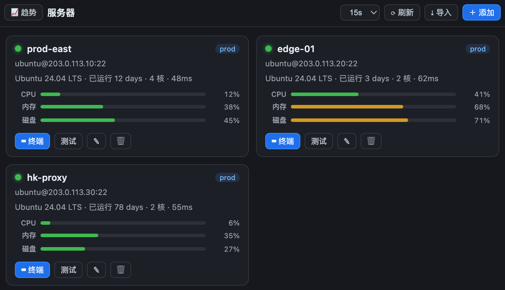
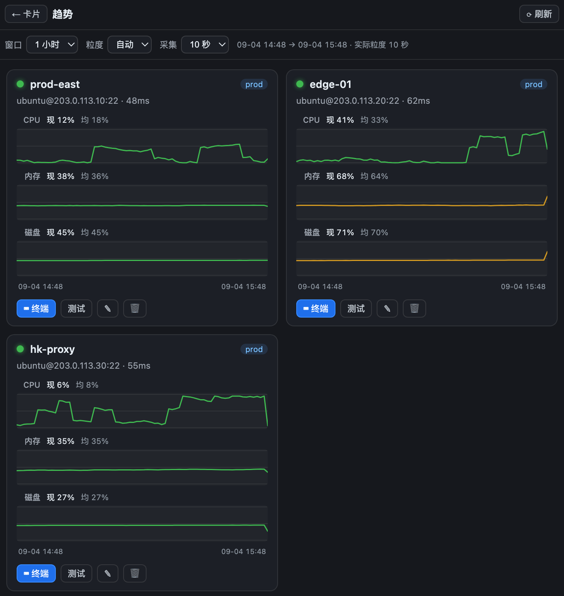
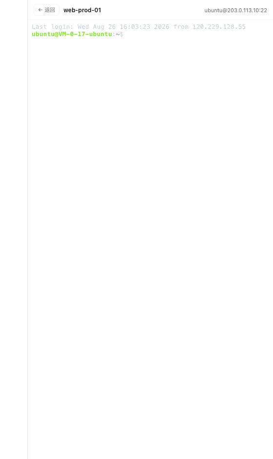
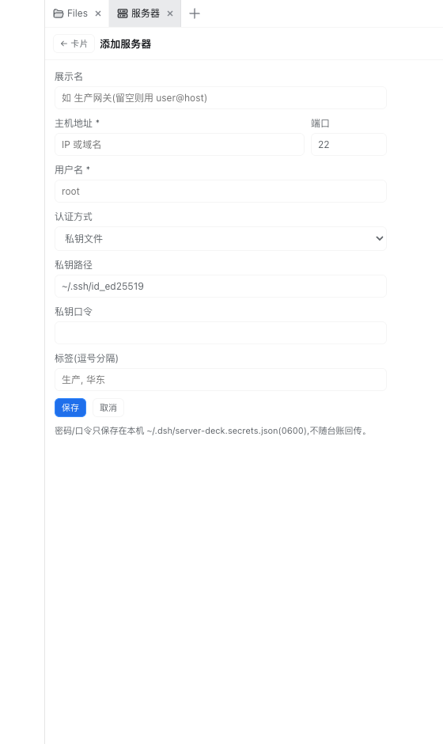

# DSH Server Deck 🖧

**DeepSeek Harness 的服务器卡片仪表盘** —— 已连接服务器的卡片视图(在线状态 / CPU / 内存 / 磁盘 / 延迟),点卡片进入 xterm.js 交互终端;独立趋势视图记录并可视化一段时间的 CPU / 内存 / 磁盘变化。

[](https://awesome-dsh-plugin.com)
[](https://github.com/topics/dsh-plugin)
[](https://www.npmjs.com/package/dsh-server-deck)
[](./LICENSE)

## 🤝 合作伙伴：米云

<a href="https://momotoken.win"></a>

**[米云 MIYUN](https://momotoken.win)** —— 多模型 AI API 聚合平台：稳定不降智，模型上线快又多；统一 API 接入、按量使用、余额集中管理。

## ⭐ 欢迎点星收藏

如果 server-deck 帮到了你，欢迎到 [GitHub 仓库](https://github.com/meyaomiao/dsh-server-deck) 点个 Star ⭐，让更多 DSH 用户看到它。问题与建议请提 Issue。

## 📋 兼容性

| 插件版本 | 状态 | 对应 DSH |
|---|---|---|
| **0.5.x**（当前主线） | ✅ | **0.2.1-rc.5 起的 0.2.1 线**；使用官方 Connection 鉴权与桌面 WebSocket transport，发版验证覆盖 `0.2.1-rc.5` |
| 0.3.x / 0.4.x | 历史版本 | 旧 DSH 原生右侧栏；建议同时升级 DSH 和插件，以获得本次终端及鉴权修复 |
| 0.2.x | 历史版本 | DSH ≤ 0.1.2-rc.1；better-sidebar 页签或独立抽屉 |

### 本次升级功能变化

- **导入先预览再确认**：先扫描 SSH 配置，查看候选、已有项及跳过原因，再勾选确认；需要的跳板依赖一起导入，取消不改台账。
- **跳板机**：手工配置与 SSH 配置导入支持 ProxyJump 链，校验缺失引用、自指和环；更新或删除跳板会让依赖连接按新配置重建。
- **终端与鉴权**：终端通过 DSH 官方 Connection 选择桌面/浏览器传输；REST 和 PTY 都检查宿主认证、Host 与 Origin，保留仅回环的访问范围。
- **升级要求**：先将 DSH 升级到 `0.2.1-rc.5` 或更新的 0.2.1 版本，再更新插件并重启宿主。无法确认鉴权能力的旧宿主会关闭插件的网络入口。

<p align="center">
  
</p>

## ✨ 功能一览

### 卡片式服务器仪表盘
每台服务器一张卡,**状态一目了然**:

| 元素 | 说明 |
|---|---|
| 🟢🟡🔴⚪ 状态点 | 在线(带呼吸光晕)/ 离线 / 探测中 / 未知 |
| 系统信息行 | OS 名称(Linux PRETTY_NAME / macOS / Windows Caption / BSD uname)、运行时长、核数、握手延迟 |
| 三条用量条 | CPU · 内存 · 磁盘,<60% 绿 / ≥60% 黄 / ≥85% 红 |
| 网速 / 本月 | 实时 ↓接收 / ↑发送(Linux 约 1s,其它系统取相邻采集点均值);本机日历月累计流量。跳过 lo / docker / veth 等虚拟口 |
| 错误详情 | 离线时内联展示失败原因(悬停看全文) |

自动刷新周期可选 **手动 / 10s / 15s / 30s / 60s**(读主机侧快照,不再现场 SSH);「刷新」按钮强制立即探测一轮。

### 📈 趋势视图
卡片与趋势两个独立视图互相切换(不是叠在卡片里)。每台主机 **CPU / 内存 / 磁盘各一张独立图**(不叠线):

| 项 | 说明 |
|---|---|
| 窗口 | 1 小时(滚动,默认)/ 24 小时(滚动)/ 一周 / 一个月(本地自然日 0 点起,含今天)/ 自定义(≤31 天) |
| 粒度 | 自动 / 10s / 30s / 1m / 5m / 15m / 1h;单次查询上限 1200 点,超限自动升档 |
| 摘要 | 最新值 + 窗口均值;悬停竖线读该时刻数值,tooltip 含最高 / 最低 / 样本数 |
| 采集 | 主机侧常驻,默认 10s(可选 30s / 1m / 5m),与面板是否打开无关;离线也记一条用于画断档 |
| 落盘 | `~/.dsh/server-deck-metrics/{hostId}/`:raw 3h、1m 24h、15m 7d、1h 31d、`net-month.json` 当月流量;删除主机级联清理 |
| 历史回填 | 窗口早于本地记录时,尝试 `sar -u` / `sar -r`(sysstat)回填 CPU / 内存;磁盘容量无法回填 |

打开「服务器」页签 → 点工具栏「📈 趋势」。窗口默认 1 小时滚动;「24 小时」也是滚动过去 24 小时,不是当天 0 点起。刚启用时图上可能只有右侧一小段,等几个采集周期就会铺开。

<p align="center">
  
</p>

### ⌨ 点卡片进交互终端
xterm.js 全功能终端:5000 行回滚、256 色、窗口尺寸实时同步、光标闪烁。Node 半区做 WebSocket ↔ ssh2 shell 双向桥。

<p align="center">
  
</p>

### ⤓ 一键导入 `~/.ssh/config`
解析标准 ssh config(Host / HostName / User / Port / IdentityFile / ProxyJump)。点击「导入」后先显示候选预览，勾选并确认后才写入台账：
- 标明通配条目、缺少用户名、已存在项与无效配置的处理原因；
- 跳过 Git 托管平台密钥别名(如 `Host github.com-xxx` / `User git`)；
- 多别名行(`Host 1.2.3.4 prod-gw`)优先取语义化别名做展示名；
- 自动包含选中主机需要的跳板；已有主机可经确认补齐缺失关联，冲突或循环不会静默变成直连；
- 检测后配置发生变化时要求重新预览，避免确认与实际写入不一致。

### ＋ 手动添加主机
密码 / 私钥文件(+口令)/ SSH Agent 三种认证;可选台账里的另一台主机作跳板机(跳板机使用自己的认证);连接测试按钮即时反馈延迟。

<p align="center">
  
</p>

## 🔀 双形态挂载

| 环境 | 形态 |
|---|---|
| 安装了 [dsh-better-sidebar](https://github.com/omdsh-dev/DSH-better-sidebar) | 注册为侧边栏「🖥 服务器」页签(order 45),原生 tab chrome、设置页开关、visible 门控轮询 |
| 未安装 | 自绘右侧可展开/收起面板:右缘竖条开关 + 拖缘调宽,宽度持久化 |

装载顺序无关:client 入口不声明强制依赖,由内层动态子插件等待服务就绪后注册页签并自动收起独立面板。

## 📦 安装

```bash
# 方式〇:npm 安装(推荐)
dsh plugin --profile web add dsh-server-deck

# 方式一:从 GitHub 直接装(dsh CLI,免 npm)
dsh plugin --profile web add github:meyaomiao/dsh-server-deck

# 方式二:克隆后本地挂载
git clone https://github.com/meyaomiao/dsh-server-deck.git
cd dsh-server-deck && pnpm install && pnpm build
dsh plugin --profile web add .
```

安装后**重启 `dsh web`**(host 半新增了路由与常驻采集器),浏览器 Ctrl+F5 强刷。侧边栏「+」菜单出现「服务器」页签即成功。

## 🔐 安全模型

- 所有 API 与 PTY 升级路由通过 DSH Connection 检查已认证 cookie、Host 与 Origin，并额外仅允许回环地址(127.0.0.1/::1)；缺少宿主鉴权 API 时返回不可用，不降为匿名访问；
- 密码 / 私钥口令单独存放 `~/.dsh/server-deck.secrets.json`(0600),台账文件不含秘密,**API 响应永不回传**;
- 删除主机仅移出台账并断开连接池,不会在远端执行任何操作;
- 对话工具 `server_deck_hosts` / `server_deck_exec` 走同一条 SSH 连接池做非交互下发,不经过卡片 xterm,也不暴露成浏览器 REST;
- 指标采集：Linux / macOS / BSD 走只读 POSIX sh 探针（固定交给 `/bin/sh`，不经过登录壳；Linux 读 `/proc`，FreeBSD/OpenBSD 读 `sysctl`，macOS Darwin 回退）。Windows OpenSSH 无 sh 时再跑一次 `powershell.exe -EncodedCommand`（CIM）。解析失败的字段显示「—」。

## 🏗️ 架构

```
┌─ Client(lib/client.js)──────────────────┐   ┌─ Host(lib/index.js)─────────────────────┐
│ 官方原生栏/better-sidebar 页签 ⇄ 独立抽屉 │◄──│ /server-deck/api/*  REST(仅回环)         │
│ React 卡片网格 / 趋势图 / 表单 / xterm.js │WS▶│ /server-deck/ws/pty ws↔ssh2 PTY 桥      │
└─────────────────────────────────────────┘   │ ssh2 连接池 · 台账 ~/.dsh/*.json         │
                                              │ MetricRecorder 常驻采集(默认 10s)        │
                                              └─────────────────────────────────────────┘
```

## 🛠️ 开发

```bash
pnpm install
pnpm build       # esbuild:server bundle + client bundle(ModuleLoader 包装)
pnpm typecheck   # tsc --noEmit
pnpm test        # 单元、HTTP/WS 鉴权、真实 SSH 跳板和回归测试；Node 20/22/24
pnpm exec playwright install chromium
pnpm test:ui     # 真实 React/xterm 浏览器布局与导入确认交互
```

核心发版链路见 [docs/core-flows.md](./docs/core-flows.md)。

改仓库前先读 [CONTRIBUTING.md](./CONTRIBUTING.md)（Issue → 分支 → Draft PR）。思考原则见 [AI-ISSUE-WORKFLOW.md](./AI-ISSUE-WORKFLOW.md)。

## License

[MIT](LICENSE)
